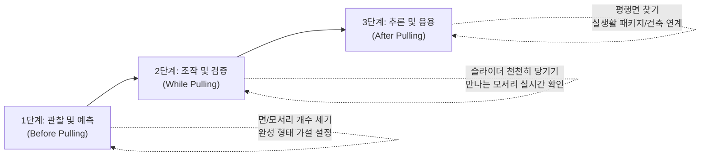

# [PRD] 매직 입체도형 3D 인터랙티브 랩 (Magic Polyhedron Lab)
> **"당기면 완성되는 매직 입체도형 전개도" 기반 초·중등 수학 공간지각력 인터랙티브 웹 플랫폼**

---

## 1. 프로젝트 개요 (Project Overview)

### 1.1 배경 및 목적
- **배경**: 기존 초등 5~6학년 및 중학교 1학년 기하 교육과정에서 '전개도와 입체도형'은 학생들이 가장 어려워하는 대표적인 추상적 단원입니다. 머릿속으로 접히는 과정을 상상(심적 회전, Mental Rotation)하기 어렵고, 기존 종이접기는 한 번 접거나 풀칠하면 되돌릴 수 없는 한계가 있습니다.
- **모티브**: YouTube Shorts 화제 영상 기반 교구인 **"평면 전개도 타공 + 당김줄(Pull String) 가역 변환 교구"**의 작동 메커니즘을 디지털 웹 공간에 완벽하게 이식합니다.
- **목적**: 웹 브라우저에서 마우스 드래그나 슬라이더로 실을 당기는 인터랙션을 통해, 2차원 평면 전개도가 실시간으로 3차원 입체도형으로 변환되는 과정을 시각적·동적으로 체험하고 수학적 개념을 직관적으로 체득하도록 돕습니다.

### 1.2 핵심 타겟 사용자
1. **학생 (초등 5~6학년, 중학교 1학년)**: 입체도형과 전개도를 시각적·체험형으로 쉽게 배우고 싶은 학생
2. **수학 교사 및 강사**: 수업 시간에 칠판이나 정적인 그림 대신 실시간 3D 변환을 시연하고 학습 도안을 출력하려는 교육자
3. **학부모**: 자녀의 공간지각능력(Spatial IQ)을 길러주고 가정에서 함께 DIY 교구를 만들어보려는 보호자

---

## 2. 핵심 가치 및 차별점 (Key Value Propositions)

| 핵심 가치 | 상세 설명 |
| :--- | :--- |
| **완벽한 양방향 가역성 (Reversibility)** | 실을 당기면(0% → 100%) 3D 입체가 되고, 풀면(100% → 0%) 다시 2D 평면으로 돌아오는 연속적인 실시간 물리/기하 시뮬레이션 |
| **당김줄(Pull String) 메커니즘 시각화** | 타공점(Punched Holes) 사이를 관통하는 실의 장력(Tension)과 수축 과정을 3D 와이어프레임과 애니메이션 라인으로 직관적 표현 |
| **5대 핵심 입체도형 완전 정복** | 삼각기둥, 직육면체, 정육면체(11종 전개도), 원기둥(곡면 롤링), 다각뿔/돔(폐곡선 루프) 지원 |
| **체험형 수학 사고력 확장** | 단순 구경을 넘어 '마주보는 평행면 찾기', '만나는 모서리 검증', '잘못된 전개도 함정 테스트' 등 능동적 문제해결 제공 |
| **온-오프라인 연계 (DIY 도안 생성)** | 웹에서 체험한 도형의 전개도, 칼선, 타공점 가이드가 포함된 실제 인쇄용 A4 도안(SVG/PDF) 즉시 출력 지원 |

---

## 3. 연계 교과과정 및 학습 성취 목표

| 대상 학년 | 단원명 | 핵심 학습 목표 | 웹 시뮬레이터 적용 기능 |
| :--- | :--- | :--- | :--- |
| **초등 5-2** | 5. 직육면체 | • 직육면체·정육면체 구성 요소(면 6, 모서리 12, 꼭짓점 8)<br>• 마주보는 평행한 면, 만나는 모서리 대응 관계 추론 | 마주보는 면 페어링 색상 하이라이트, 모서리 접합 애니메이션 |
| **초등 6-1** | 2. 각기둥과 각뿔 | • 각기둥의 밑면 2개와 직사각형 옆면 구조<br>• 각뿔의 밑면 1개와 삼각형 옆면 수렴 구조 이해 | 삼각기둥 vs 다각뿔 비교 모드, 당김줄에 의한 각뿔 꼭짓점 수렴 시각화 |
| **초등 6-2** | 6. 원기둥, 원뿔, 구 | • 원기둥 전개도 원리 (직사각형 가로 = 밑면 둘레 $2\pi r$, 세로 = 높이 $h$) | 직사각형이 둥글게 말려 원형 밑면을 감싸는 곡면 롤링 인터랙션 |
| **중1-2** | Ⅵ. 입체도형 | • 정다면체 전개도 공간 위치 관계 분석<br>• 회전체 및 겉넓이·부피 공식의 기하학적 토대 | 정육면체 11가지 전개도 비교 실험실, 모서리 길이와 면적 계산기 |

---

## 4. 상세 기능 명세 (Functional Specifications)

### 4.1 F1. 3D 인터랙티브 가역 폴딩 뷰어 (Core Simulation Engine)
- **당김줄(Pull String) 컨트롤러**:
  - 화면 하단 대형 슬라이더 및 'PULL' 태그 손잡이 UI 제공.
  - 마우스 드래그 / 모바일 터치 스와이프로 0% (완전 평면 2D) ~ 100% (완성 입체 3D) 실시간 부드러운 보간 제어.
  - '자동 재생/일시정지 (Play/Pause)' 및 '속도 조절 (0.5x, 1x, 2x)' 버튼 제공.
- **3D 카메라 인터랙션**:
  - 마우스 좌클릭 드래그: 360도 자유 궤도 회전 (OrbitControls).
  - 휠 스크롤: 줌 인 / 줌 아웃.
  - 우클릭 드래그: 화면 패닝 (Pan).
  - '카메라 뷰 리셋' 버튼: 기본 정면 아이소메트릭(Isometric) 뷰 복귀.
- **시각화 모드 토글 (Display Options)**:
  - **투명도(X-Ray) 모드**: 면을 반투명하게 만들어 내부 실의 교차 및 타공점 궤적 관찰.
  - **모서리/꼭짓점 강조 모드**: 서로 맞닿을 모서리를 동일한 색상의 네온 라인으로 하이라이트.
  - **타공점 & 실(String) 표시**: 실의 장력 텐션을 시각적인 3D 선형 튜브/라인으로 렌더링.
  - **접는 각도(Fold Angle) 인디케이터**: 면들이 일어날 때의 각도($0^\circ \sim 90^\circ$ 등) 실시간 수치 표시.

---

### 4.2 F2. 5대 입체도형 모듈별 특화 인터랙션

#### ① 삼각기둥 (Triangular Prism)
- **구성**: 정삼각형 밑면 2개, 직사각형 옆면 3개, 모서리 9개, 꼭짓점 6개.
- **인터랙션 특화**:
  - 평면 상태에서 가장 멀리 떨어져 있던 두 점이 실을 당길 때 거리 $d \to 0$으로 수렴하는 물리 궤적 표시.
  - 밑면 2개가 90도로 기립 후 직사각형 옆면이 닫히는 명쾌한 2단계 접힘 시각화.

#### ② 직육면체 / 사각기둥 (Cuboid)
- **구성**: 직사각형 6개 (합동 3쌍), 모서리 12개, 꼭짓점 8개.
- **인터랙션 특화**:
  - 교차 대각선 실 궤적 시각화: 두 가닥의 실이 교차 타공을 관통하여 장력이 전달되는 구조.
  - 평행한 세 쌍의 면을 파스텔 색상(예: 파랑, 노랑, 초록 쌍)으로 구분하여 마주보는 면 자동 탐색 지원.

#### ③ 정육면체 11종 전개도 실험실 (Cube 11 Nets Lab)
- **구성**: 크기가 같은 정사각형 6개.
- **인터랙션 특화**:
  - 수학적으로 성립하는 **11가지 정육면체 전개도** 썸네일 그리드 제공.
  - 각 전개도 선택 시 실시간 폴딩 가능 여부 시뮬레이션.
  - **"어떤 전개도가 실 당김 교구로 가장 적합할까?" 탐구 모드**: 연속된 변의 개수와 실의 마찰 저항도를 분석하여 최적 도안 추천 (계단형 vs T자형 등).
  - **오답 전개도 테스트**: 면이 겹치거나 닫히지 않는 잘못된 전개도를 당겼을 때 걸려 접히지 않는 물리적 피드백 시각화.

#### ④ 원기둥 (Cylinder) - 곡면 롤링 & 공식 시각화
- **구성**: 원형 밑면 2개, 직사각형 옆면 1개.
- **인터랙션 특화**:
  - 직사각형 평면이 둥글게 곡면(Mesh Deformation)으로 말리며 원형 뚜껑과 결합하는 롤링 애니메이션.
  - **공식 실시간 매칭**:
    - 직사각형 가로 길이 = 밑면 원둘레 ($2\pi r$)
    - 직사각형 세로 길이 = 원기둥 높이 ($h$)
    - 실을 당겨 원형 밑면 테두리에 가로 변이 정확히 맞아떨어지는 과정을 길이 측정선으로 시각화.

#### ⑤ 다각뿔 & 돔형 다면체 (Polygonal Pyramid / Dome)
- **구성**: 밑면 다각형(삼각/사각/오각/육각 선택 가능) + 삼각형 옆면들.
- **인터랙션 특화**:
  - **폐곡선 루프(Drawstring) 메커니즘**: 별 모양 전개도의 꼭짓점들을 감싼 원형 실 루프가 조여지며 단 하나의 꼭짓점으로 수렴하는 모션.
  - **STEAM 공학 연계 팝업**: 텐트 폴대 구조, 우산 프레임, 지오데식 돔(Geodesic Dome)과의 공학적 원리 비교 뷰.

---

### 4.3 F3. 3단계 발문 기반 탐구 학습 & 퀴즈 모드 (Inquiry & Quiz)

교구 설명서 Section 5의 '아이의 생각을 깨우는 3단계 발문'을 인터랙티브 퀘스트로 구현:



1. **Step 1: Before Pulling (예측 모드)**
   - 평면 전개도 상태에서 질문 제시: "이 전개도를 접으면 면과 모서리는 몇 개일까요?", "1번 면과 마주보는 면은 몇 번일까요?"
   - 학생이 화면에서 번호가 매겨진 면을 클릭하여 예측 답안 제출.
2. **Step 2: While Pulling (조작 & 검증 모드)**
   - 슬라이더를 서서히 당겨보면서 학생이 선택한 면과 모서리가 실제로 어떻게 만나는지 슬로우 모션으로 확인.
   - 오답이었을 경우, 왜 겹치거나 평행하지 않는지 물리적 3D 모션으로 즉시 피드백.
3. **Step 3: After Pulling (추론 & STEAM 응용 모드)**
   - "우유갑, 과자 상자는 어떤 전개도로 만들어졌을까?"
   - 전개도 마스터 체크리스트 (4개 핵심 문항) 달성 뱃지 수여.

---

### 4.4 F4. DIY 도안 스튜디오 & 원클릭 인쇄 (Printable Blueprint Studio)
- **기능 설명**: 가정이나 교실에서 도화지(180~250g)와 실을 이용해 직접 만들 수 있도록 정밀 치수의 도안을 생성하고 인쇄합니다.
- **도안 포함 요소**:
  - **외곽 자르는 선**: 굵은 실선
  - **접는 칼선(누름선/오시)**: 점선 또는 파선
  - **타공 위치(Punched Holes)**: 모서리 끝 3~5mm 지점에 직경 3~4mm 펀치 표시 (빨간 도트 및 보강 테이프 가이드선)
  - **PULL 손잡이 탭**: 실 묶음 고정용 라벨 영역
- **인쇄 옵션**:
  - 용지 크기 선택 (A4 / B4)
  - 난이도별 가이드 텍스트 포함 여부 토글
  - 브라우저 인쇄(`window.print()`) 최적화 CSS 및 SVG 다운로드 지원.
  - DIY 제작 5단계 가이드 & 실패 방지 3대 꿀팁(마찰 최소화, 테이프 보강, 실 여유 길이) 팝업 인쇄 시 포함.

---

### 4.5 F5. 교사 및 학부모 전용 대시보드 / 가이드
- **초등/중등 교육과정 연계 해설서 모달**: 2022 개정 교육과정 성취 기준 및 단원별 지도 가이드.
- **단원 마스터 체크리스트**:
  - [ ] 밑면과 옆면 구분 (기둥 밑면 2개 vs 각뿔 밑면 1개)
  - [ ] 평행한 면 찾기 (직육면체 마주보는 3쌍의 면)
  - [ ] 만나는 모서리 대응 관계 파악
  - [ ] 원기둥 전개도 원리 (가로 길이 = 밑면 둘레 $2\pi r$)
- 학생에게 질문을 던질 수 있는 추천 발문 리스트 클립보드 복사 기능.

---

## 5. UI/UX 디자인 및 화면 설계 (UI/UX Architecture)

### 5.1 전체 레이아웃 구조

```
+------------------------------------------------------------------------------------+
|  [Logo] 매직 입체도형 3D 랩     [도형 선택 드롭다운/탭]       [학습모드|DIY도안|가이드] [다크/라이트] |
+------------------------------------------------------+-----------------------------+
|                                                      |  [우측 패널: 도형 정보 & 학습] |
|                                                      |  - 도형 정보 (면, 모서리, 꼭짓점) |
|               [ 메인 3D 뷰포트 ]                     |  - 기하학적 핵심 포인트         |
|                                                      |  - 마주보는 면 / 만나는 선 하이라이트|
|  - 360도 회전 / 줌 / 팬 인터랙션                     |  - 발문 탐구 퀘스트             |
|  - 전개도 접힘 실시간 3D 렌더링                      |  - 공식 시각화 ($2\pi r$ 등)   |
|  - 플로팅 툴바: [투명도] [와이어] [하이라이트] [리셋]  |                             |
|                                                      |                             |
+------------------------------------------------------+-----------------------------+
|  [ 하단 인터랙션 컨트롤 바 ]                                                       |
|  [⏮ 처음] [▶ 재생/정지]  ==== [ PULL 당김줄 슬라이더 (0% ~ 100%) ] ==== 탭 당기기 🏷️ |
+------------------------------------------------------------------------------------+
```

### 5.2 디자인 시스템 (Design System)
- **테마 & 분위기**: 현대적이고 깔끔한 에듀테크 스타일 (Apple Educational / Khan Academy 스타일).
- **메인 컬러 팔레트**:
  - Primary Indigo: `#4F46E5` (당김줄, 메인 액션)
  - Accent Coral / Pink: `#F43F5E` (타공점, 경고, PULL 태그)
  - Shape Colors:
    - 밑면(Base): Emerald Teal (`#10B981`)
    - 옆면(Side): Sky Blue (`#0EA5E9`)
    - 하이라이트 대응면: Soft Amber (`#F59E0B`) & Purple (`#A855F7`)
  - Background: Clean Neutral (`#F8FAFC` 라이트 / `#0F172A` 다크)
- **반응형 대응**:
  - 데스크톱: 좌측 3D 캔버스 (70%) + 우측 인스펙터 패널 (30%)
  - 태블릿/모바일: 전체화면 3D 캔버스 + 하단 시트(Bottom Sheet) 형태의 정보창

---

## 6. 기술 아키텍처 및 구현 스택 (Technical Architecture)

### 6.1 추천 기술 스택
- **프레임워크 / 라이브러리**:
  - **HTML5, Modern JavaScript/TypeScript**: 유지보수와 독립 실행이 용이한 가벼운 구성
  - **Three.js (r128+)**: WebGL 기반 고성능 3D 렌더링, Matrix 변환 및 계층형 관절(Hinged Joint) 구조 모델링
  - **Tailwind CSS**: 모던하고 직관적인 유틸리티 퍼스트 반응형 스타일링
  - **Lucide Icons**: 깔끔하고 직관적인 교육용 UI 아이콘 세트
  - **Canvas / SVG**: DIY 전개도 정밀 벡터 생성 및 인쇄용 렌더링
  - **Vite**: 초고속 번들러 및 개발 서버 환경

### 6.2 3D 폴딩 메커니즘 알고리즘 (Kinematics & Folding Algorithm)
- **Hinged Mesh Tree (계층형 힌지 구조)**:
  - 기준면(Base Face)을 Scene의 루트에 고정.
  - 인접한 면들을 자식(Child Object3D)으로 계층 바인딩하고, 공유 모서리를 회전축(Pivot Axis)으로 설정.
  - 슬라이더 값($t \in [0, 1]$)에 따라 각 힌지의 오일러 각도 회전 적용 ($\theta = t \times \theta_{target}$).
- **원기둥 롤링 (Cylinder Rolling)**:
  - 직사각형 세그먼트 메쉬(PlaneGeometry with subdivision)의 버텍스들을 $t$에 따라 평면에서 원통형 좌표계로 모핑(Morphing / Vertex Shader or Procedural Update).
- **당김줄(Pull String) 물리적 근사 렌더링**:
  - 각 면의 타공점 월드 좌표($P_1, P_2, \dots$)를 매 프레임 계산.
  - 점들을 잇는 `CatmullRomCurve3` 또는 `LineSegments`로 실을 렌더링하고, $t$가 증가함에 따라 타공점 간 거리가 좁혀지며 실이 팽팽해지는 텐션 표현.

---

## 7. 개발 로드맵 및 단계별 마일스톤 (Milestones)

### Phase 1: 기반 구축 및 삼각기둥/정육면체 프로토타입 (Week 1)
- [x] 요구사항 분석 및 PRD 작성
- [ ] Vite + Three.js + Tailwind CSS 기반 프로젝트 환경 셋업
- [ ] 계층형 힌지(Hinge) 회전 엔진 구현
- [ ] 삼각기둥 & 직육면체 3D 모델링 및 0~100% 당김 애니메이션 구현
- [ ] OrbitControls 카메라 및 기본 PULL 슬라이더 컨트롤러 연동

### Phase 2: 5대 도형 완성 및 시각 효과 (Week 2)
- [ ] 정육면체 11종 전개도 데이터셋 및 전환 기능 구현
- [ ] 원기둥 곡면 롤링(Cylinder Rolling) 알고리즘 구현
- [ ] 다각뿔 돔(Drawstring Loop) 수렴 메커니즘 구현
- [ ] 타공점(Holes) 및 당김줄(String) 3D 실시간 렌더링
- [ ] X-Ray 투명도, 모서리 하이라이트 토글 기능

### Phase 3: 교육 인터랙션 & 퀴즈 모드 (Week 3)
- [ ] 3단계 발문(Before/While/After) 인터랙티브 가이드 모드 추가
- [ ] 마주보는 면 찾기 및 만나는 모서리 검증 퀴즈 시스템
- [ ] 잘못된 전개도(오답 함정) 당김 저항/충돌 시뮬레이션
- [ ] 단원 마스터 체크리스트 및 성취도 피드백

### Phase 4: DIY 도안 스튜디오 & 완성도 고도화 (Week 4)
- [ ] SVG 기반 정밀 전개도 벡터 렌더러 (타공점, 칼선, 자르는 선)
- [ ] 원클릭 A4 인쇄 최적화 스타일시트 적용
- [ ] 교사용/학부모용 가이드 모달 및 실전 꿀팁
- [ ] 크로스 브라우징(Chrome, Safari, Edge) 및 모바일/태블릿 터치 반응성 최적화

---

## 8. 성공 측정 지표 (KPIs)

1. **학습 몰입도**: 학생 평균 인터랙션 시간 5분 이상, 도형당 당김/풀림 반복 횟수 4회 이상.
2. **개념 이해도**: '마주보는 평행면' 및 '만나는 모서리' 퀴즈 정답률 85% 이상 달성.
3. **교구 활용도**: DIY 도안 출력/저장 기능 활용 비율 30% 이상.
4. **성능 지표**: 저사양 기기(태블릿, 크롬북)에서도 안정적인 60 FPS 렌더링 유지.

---

*본 문서는 PDF 설명서 '입체도형_전개도_교구_설명서.pdf'의 교육 원리 및 메커니즘을 기반으로 작성되었습니다.*
